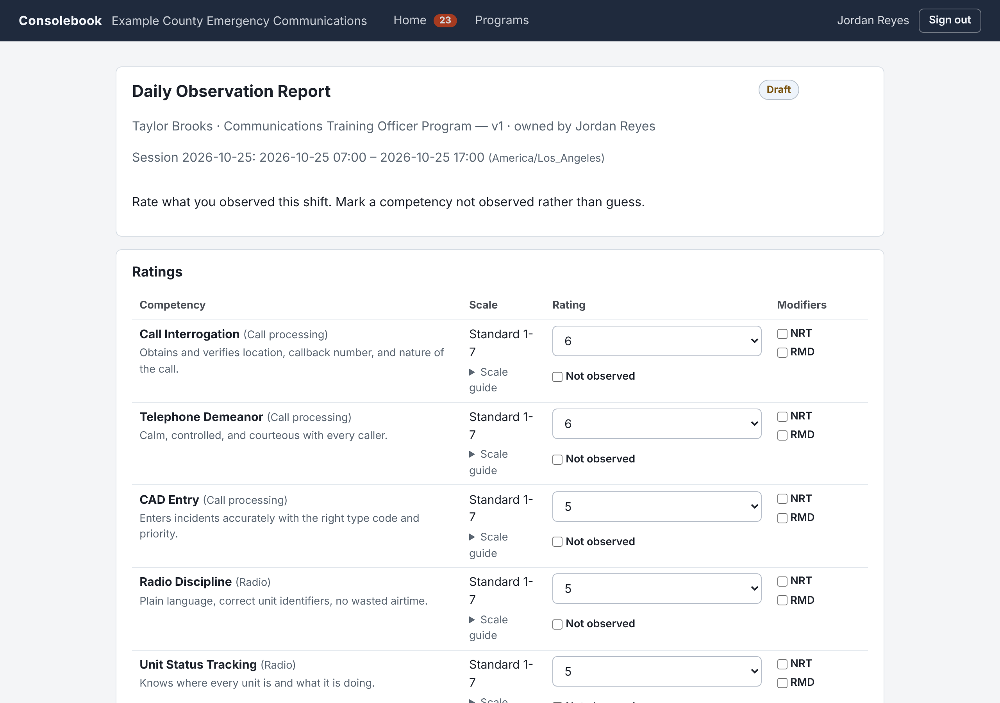
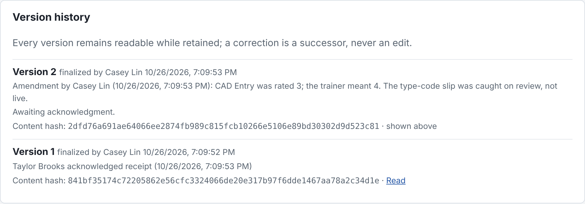
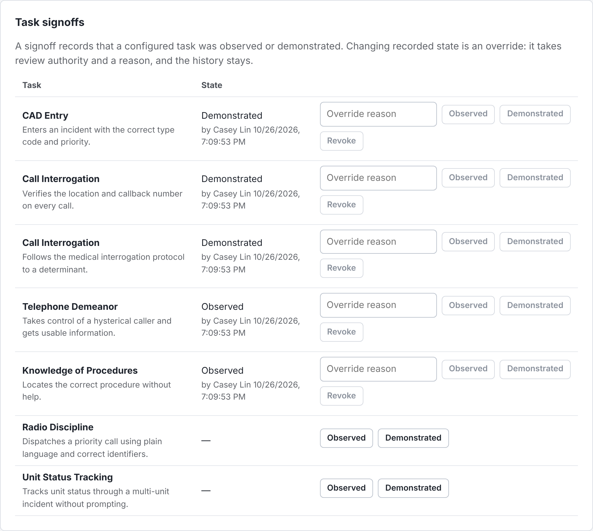
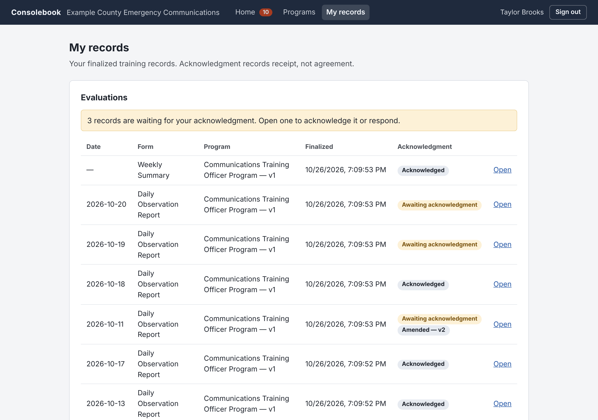

# Consolebook

Training records for 911 centers: daily observation reports, weekly summaries,
task signoffs, and each trainee's complete file, in one program a center runs
on its own server. Free and open source under the AGPL.

Consolebook is a [Fieldmouse Works](https://github.com/FieldmouseWorks) project — open tools for closed systems.



> **Status:** pre-alpha, version 0.3.0 ([changelog](CHANGELOG.md)). The
> application is usable for development and evaluation, not production. Do not
> put production or personnel data into this repository or any current build.
> What is done and what is next: [roadmap](docs/roadmap.md).

## Why it exists

A new 911 dispatcher spends months in a training program, and every shift of
it produces a daily observation report from their trainer. Those reports
decide whether the trainee is released to work alone, and they come back years
later in grievances, decertifications, and lawsuits. Most centers keep them on
paper, in spreadsheets, or in a hosted product they rent.

Consolebook is written by a working 911 dispatcher to keep those records the way
they need to be kept: a finalized report never changes, a correction is a new
version with its reason, every version stays readable and verifiable, and the
agency can take everything with it in an open format.

## What it does

- **Programs are configuration.** Phases, competencies, tasks, rating scales,
  and forms are versioned per agency; a record stays pinned to the exact
  program version it was written under.
- **Daily observation reports.** Trainers draft together with autosave and
  per-person attribution, submit for review, and finalize. Sessions keep the
  agency's local dates and shift times.
- **Finalized means final.** A finalized record is stored as canonical bytes
  with a content hash and a hash chain. Corrections are amendments that seal
  the next version; the original stays readable.
- **Acknowledgment records receipt, not agreement.** Trainees acknowledge,
  respond, or refuse, and supervisors can attest on their behalf, per version.
- **Weekly summaries and task signoffs.** Summaries link the exact daily
  report versions they cover. Signoffs keep their full history, including
  overrides and the reasons for them.
- **Trainees see their own file** and can download it as a packet.
- **Exports verify from the file alone**, anywhere, with
  `consolebook-server export verify`: one record, one trainee's packet, or the
  whole installation.
- **Retention policies and record holds** are explicit, attributed workflows.
- **Easy to run.** One executable and one SQLite data directory. A
  one-command install and upgrade on Linux, automatic validated backups
  (copied off the server when you give it a second disk), and a read-only
  `doctor`.

| | |
| --- | --- |
|  |  |
| Amendments seal a new version; the original and its acknowledgment stay. | Signoffs record observed or demonstrated, by whom, and every override. |
|  | |
| A trainee's own records and what still awaits their acknowledgment. | |

The screenshots show invented data from the demo below.

## Try the demo

With Rust and Node.js 24 installed (or `nix develop`, which provides both):

```sh
git clone https://github.com/FieldmouseWorks/consolebook && cd consolebook
(cd web && npm ci && npm run build)
cargo build -p consolebook-server
(cd web && npm run demo)
```

It serves a throwaway installation at <http://127.0.0.1:7770>, filled with an
invented agency's training program, two trainees, and a few weeks of records,
and prints the accounts to sign in as. Ctrl-C stops it and deletes the data.

## How it is built

- Rust and Axum for the application and HTTP API; SQLx with SQLite in WAL mode
  for storage.
- A statically built SvelteKit interface embedded in the executable; Node.js
  is a build tool only.
- Opaque server-side sessions with Argon2id password hashes. Access is scoped
  to a trainer's own assignments by default, and authorization is decided in
  domain services, never in handlers or the UI.
- A modular monolith: one executable and one data directory per agency, no
  external services, no telemetry.
- Every product decision is an [architecture decision record](docs/decisions/);
  [PRINCIPLES.md](PRINCIPLES.md) holds the constraints they answer to.
- Formatting, Clippy with warnings as errors, the Rust test suite, and
  Playwright tests against the real compiled binary gate every change
  ([CONTRIBUTING.md](CONTRIBUTING.md)).

Lawful disposition, attachments, and PDF rendering (Typst) are still to come.
The [preview runbook](docs/preview.md) covers the live demonstration
deployment; local builds do not update it.

## Install

On a Linux server with systemd (x86_64 or arm64):

```sh
curl -fsSL https://github.com/FieldmouseWorks/consolebook/releases/latest/download/install.sh | sudo sh
```

It prints the address and a setup code; finish in the browser, and the home
page walks you through the first day. Run the same command to upgrade. Give it
`-s -- --backup-dir /mnt/your-second-disk` (after `sudo sh`) so every automatic
backup is also copied off the server's own disk; without it, the installer and
the administrator's home both warn until you do.
[docs/install.md](docs/install.md) covers network access, backups, and the rest.
[docs/operations.md](docs/operations.md) covers what to watch, the logs, and how to
report a problem.

## Non-goals

- A multi-tenant schema in the core application.
- A generic drag-and-drop form builder.
- Agency-specific code paths.
- Cloud services, telemetry, or containers as runtime requirements.
- Editing finalized records in place.

## Repository map

- [PRINCIPLES.md](PRINCIPLES.md) — non-negotiable product constraints
- [AGENTS.md](AGENTS.md) — repo-wide contract for contributors and agents
- [docs/architecture.md](docs/architecture.md) — implemented boundaries and remaining design targets
- [docs/domain-model.md](docs/domain-model.md) — domain vocabulary and invariants
- [docs/records-integrity.md](docs/records-integrity.md) — immutability, hashes, and provenance
- [docs/development.md](docs/development.md) — runtime flow, source ownership, and local workflow
- [docs/roadmap.md](docs/roadmap.md) — milestone sequence
- [CONTRIBUTING.md](CONTRIBUTING.md) — contribution lifecycle and verification commands
- [docs/decisions/](docs/decisions/) — architecture decision records
- [crates/consolebook-server/](crates/consolebook-server/) — the server crate

## Build and run from source

```sh
(cd web && npm ci && npm run build)               # build the interface (embedded by cargo)
cargo run -p consolebook-server -- serve                   # initialize ./data and serve UI + API
cargo run -p consolebook-server -- doctor                  # read-only database diagnostics
cargo run -p consolebook-server -- backup                  # validated snapshot into ./data/backups
cargo run -p consolebook-server -- restore <snapshot>      # recover from a snapshot (server stopped)
cargo run -p consolebook-server -- setup-code              # fresh first-run setup code
cargo run -p consolebook-server -- recover --username ...  # rescue a locked-out administrator
cargo run -p consolebook-server -- export verify <archive> # verify an export without an installation
```

`serve` binds `127.0.0.1:7770` by default and serves the web interface and
the API from one process. An uninitialized installation prints a
short-lived setup code; open the interface in a browser to create the
agency and first administrator, then sign in. The data directory defaults
to `./data` and can be set with `--data-dir` or `CONSOLEBOOK_DATA_DIR`.
Node.js is a build-time tool only — production runs the one executable. See
[ADR 0003](docs/decisions/0003-sqlite-connection-invariants.md) for database
durability, [ADR 0004](docs/decisions/0004-local-authentication.md) for
authentication, and [ADR 0005](docs/decisions/0005-embedded-web-interface.md)
for the embedded interface.

`doctor` opens the database read-only and reports journal mismatches without
repairing them. It also reports every recorded migration that `serve` would
refuse to start on: a version this build does not know, a changed checksum,
or a migration recorded as unsuccessful. SQLite may create WAL sidecars or
update shared-memory coordination; read-only storage without usable sidecars
can prevent diagnosis.
Its connection-local PRAGMA checks describe the diagnostic connection.
See [ADR 0016](docs/decisions/0016-read-only-diagnostics.md) for the precise contract.

## Versions and releases

Releases follow Semantic Versioning, pre-1.0 ([ADR 0022](docs/decisions/0022-product-versioning.md)).
`consolebook-server --version`, `/api/health`, and the interface footer report the version
and the source commit of the running build. Changes are listed in [CHANGELOG.md](CHANGELOG.md);
the procedure is in [docs/releasing.md](docs/releasing.md).

## Privacy

Examples, test fixtures, and screenshots must be invented. Do not commit real agency names, employee information, operational narratives, credentials, exports, screenshots of real installations, or training records.

## License

Consolebook is licensed under the [GNU Affero General Public License v3.0 only](LICENSE). If you modify Consolebook and let users interact with it over a network, AGPLv3 requires you to offer those users the Corresponding Source for the running modified version.

See [ADR 0002](docs/decisions/0002-license.md) for the decision and trade-offs.
